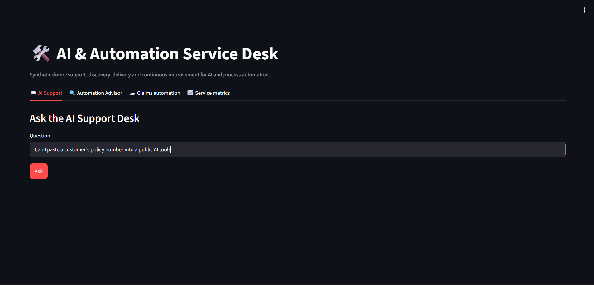
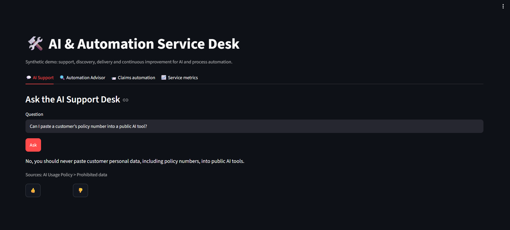
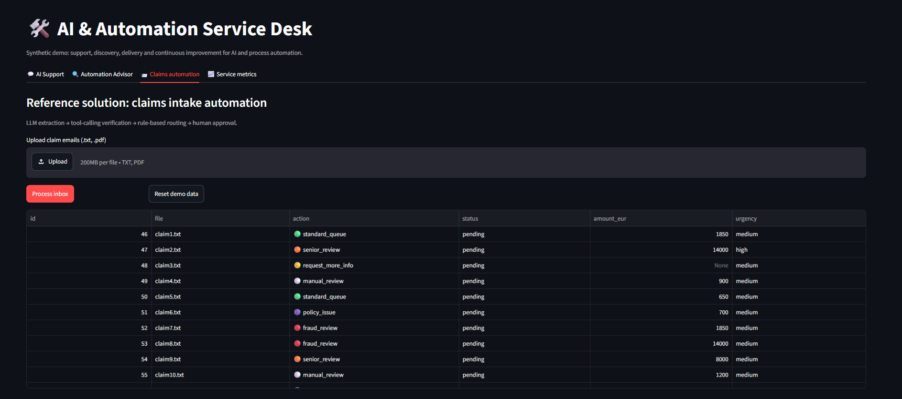

# AI & Automation Service Desk

A demo of an internal AI and automation team for an insurance company: it answers staff questions about AI tools, assesses automation ideas, and runs a reference claims automation. **Synthetic data only.**

**Live demo: https://ai-automation-service-deskgit-5har5hy28hwcbxj3rcjtqt.streamlit.app/**
**Password: servicedesk-2026**

(The app may sleep when idle. Click the wake-up button and wait a moment.)





## What it does

- **AI Support:** a RAG assistant answers from a small knowledge base with source citations, and escalates questions it can't answer reliably (logged as knowledge gaps).
- **Automation Advisor:** turns a manual process description into a recommended approach (RPA, GenAI extraction, agent, hybrid or not suitable), a priority score and a workshop brief.
- **Claims automation:** an LLM extracts fields from claim emails, a tool-calling agent checks the policy register and duplicates, and plain rules route each claim. A human approves every reply.
- **Service metrics:** escalation rate, answer ratings, knowledge gaps, automation backlog and claim routing.

## Safeguards

- Rules, not the LLM, make routing decisions. Missing fields stay empty and are never guessed.
- Emails are treated as untrusted. Prompt-injection detection sends suspicious emails to manual review.
- Agent limited to two allowlisted tools and 4 steps. No email is sent automatically.
- Support answers only from the knowledge base and escalates otherwise.

## Evaluation (`python eval.py`)

| Test set | Result |
|---|---|
| Claim routing, 7 original emails (used while tuning) | 7/7 |
| Claim routing, 5 new emails (first run) | 5/5 |
| Support: answer vs escalate, 4 questions | 4/4 |

The first run found two failures: the injection detector flagged ordinary requests like "Please help". I tightened its definition and reran.

**Limitations:** small synthetic test set written by the same person who designed the rules, so it shows the pipeline behaves as designed, not that it works on real claims. LLM output can vary between runs. The Advisor is checked by hand, not by `eval.py`. Its priority score is a simple heuristic (0.6 × impact + 0.4 × feasibility).

## Tech

Python, OpenAI API (structured outputs, tool calling, embeddings), Pydantic, Streamlit, SQLite, pandas.

## Run locally

```
python -m venv .venv
.venv\Scripts\activate
pip install -r requirements.txt
set OPENAI_API_KEY=your_key
python eval.py
streamlit run app.py
```

Portfolio project. All names, policy numbers and emails are invented. Not for real customer data.
